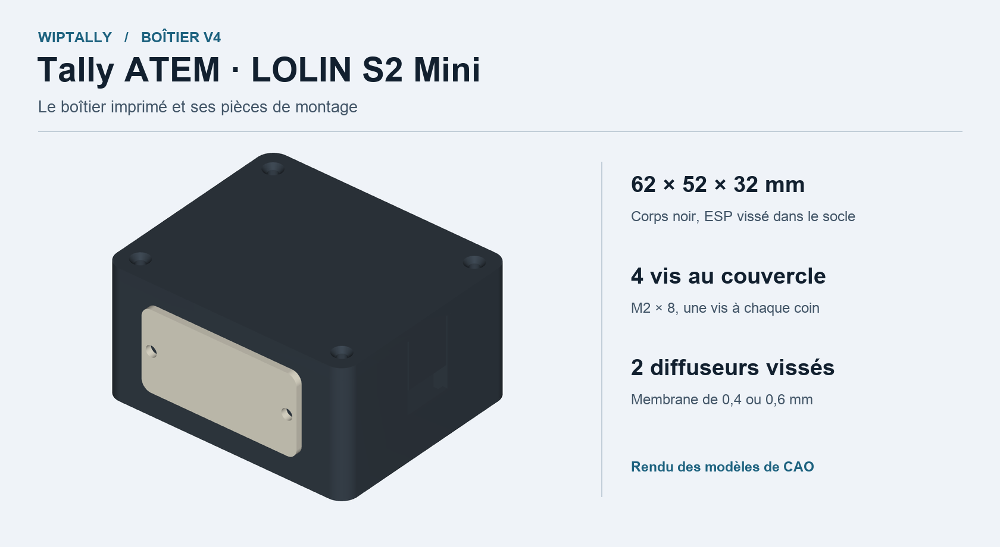
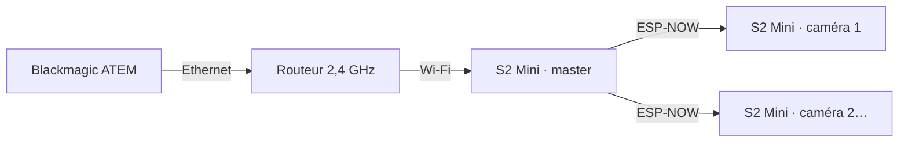

# WIPTally

Voyants tally sans fil pour mélangeur Blackmagic ATEM. Une **LOLIN S2 Mini** rejoint le Wi-Fi 2,4 GHz et transmet les états Programme et Preview aux récepteurs via ESP-NOW. **Tally Atelier** configure et flashe les cartes en USB. La version 1.5 utilise ESP-NOW Long Range et transmet la luminosité choisie sur le master à tous les récepteurs RGB.

## Démarrer

1. Télécharger ou cloner le dépôt, puis ouvrir [le dossier S2Mini](S2Mini).
2. Lancer **Tally Atelier.app** ou **Lancer-Tally.command** sur Mac, **Lancer-Tally.bat** sur Windows. Le premier lancement installe les dépendances Python de flash. Les quatre profils disposent d'images compilées.
3. Brancher le master avec un câble USB de données. Saisir le réseau Wi-Fi 2,4 GHz, l'adresse IP de l'ATEM et le nombre d'entrées utilisées. Vérifier la préparation, puis flasher.
4. Brancher un récepteur, sélectionner son numéro de caméra et son type de LED, puis flasher. Pour deux WS2812, utiliser le profil **Récepteur RGB**. Le niveau initial se choisit dans le profil Master et se règle ensuite par son bouton.
5. Relier l'ATEM au routeur en Ethernet. Vérifier Programme, Preview et la reprise après une coupure réseau.

Pour passer à la version 1.5, flasher les récepteurs avant le master.

[Guide de démarrage](S2Mini/COMMENCER-ICI.md) · [Application](S2Mini/APPLICATION.md) · [Configuration et dépannage ATEM](S2Mini/README.fr.md) · [Câblage WS2812](S2Mini/LED-RGB.md) · [Bouton de luminosité du master](S2Mini/BOUTON-LUMINOSITE.md)

| État du récepteur RGB | Signal |
| --- | --- |
| Programme | Rouge |
| Preview | Vert |
| Repos | Éteint |
| Recherche du master ou ATEM indisponible | Bleu clignotant |

## Boîtier imprimable V4

Corps **62 × 52 × 32 mm**, couvercle à **quatre vis M2 × 8** et deux diffuseurs blancs imprimés à plat. Les diffuseurs se posent depuis l'extérieur avec deux **M2 × 5** chacun. Le cadre de 1,6 mm reçoit les vis et laisse une membrane centrale de **0,4 ou 0,6 mm**. Les supports LED de V3 peuvent être réutilisés.

| Ressource | Fichiers |
| --- | --- |
| Dossier complet | [Archive STEP, STL et sources V4](hardware/boitier-tally/V4/Boitier-Tally-V4-62x52x32-STEP-STL.zip) |
| Impression | [STL par pièce et coupons](hardware/boitier-tally/V4/STL) |
| CAO | [STEP par pièce et assemblage](hardware/boitier-tally/V4/STEP) |
| Montage | [Guide d'impression et de montage](hardware/boitier-tally/V4/LIRE-AVANT-IMPRESSION.md) |
| Conception | [Vues, planches et versions précédentes](hardware/boitier-tally/README.md) |

La V4 a passé les contrôles numériques de géométrie. Le coupon de fixation permet d'essayer les jeux de vis et le diffuseur avant de réimprimer le socle.

## Profils et sources

| Profil | Carte | Fonction |
| --- | --- | --- |
| Master ATEM | LOLIN S2 Mini | Wi-Fi et lecture des états tally |
| Récepteur ATEM | LOLIN S2 Mini | LED intégrée ou sorties rouge et verte |
| Récepteur RGB ATEM | LOLIN S2 Mini | Deux WS2812 sur GPIO18 |
| Sony REC expérimental | LOLIN C3 Mini | Voyant REC autonome en Bluetooth LE pour Sony A7 IV |

[Guide Sony et statut de validation](S2Mini/SONY.md) · [Sources et images de flash](S2Mini) · [Licence du portage](S2Mini/LICENSE)

Le portage S2 Mini s'appuie sur le projet [jkowalk/esp-now-atem-tally](https://github.com/jkowalk/esp-now-atem-tally). Les sources historiques pour WT32-ETH01 et ESP8266 et leurs modèles sont disponibles avec leur documentation d'origine. [Documentation historique](docs/ATEM-HISTORIQUE.md)
