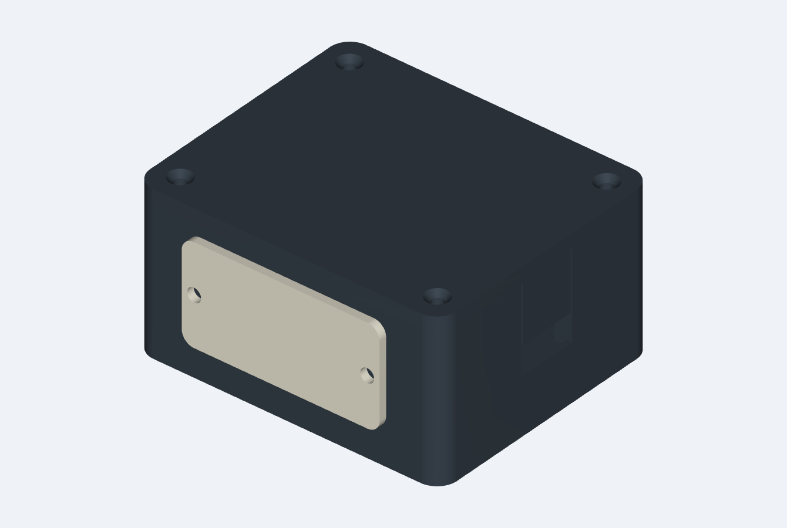
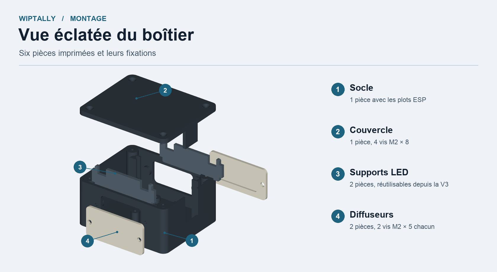
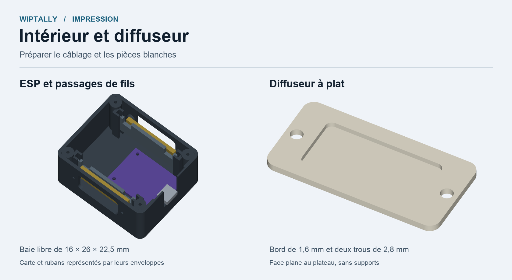

# Boîtier Tally pour S2 Mini

La **V4** reprend le montage ESP et LED de la V3. Le couvercle est vissé aux quatre coins. Les diffuseurs se posent depuis l'extérieur sur les fenêtres et s'impriment à plat, sans supports.

| Pièce | Nombre | Impression |
| --- | ---: | --- |
| Socle | 1 | Noir, fond au plateau |
| Couvercle | 1 | Noir, face extérieure au plateau |
| Support LED | 2 | Noir, pièces V3 réutilisables |
| Diffuseur | 2 | Blanc, membrane de 0,4 mm ou 0,6 mm, face plane au plateau |

Prendre les STL dans leur orientation fournie, à 100 % et en millimètres. Pour un premier essai, imprimer le **coupon de fenêtre** et un diffuseur en couches de 0,2 mm. Choisir une seule épaisseur de membrane pour les deux faces du boîtier.

[Coupon STL](V4/STL/TEST_fenetre_et_vis_diffuseur.stl) · [Diffuseur 0,6 mm](V4/STL/OPTION_diffuseur_plat_blanc_06mm_x2.stl) · [Montage et visserie](V4/LIRE-AVANT-IMPRESSION.md)

[Vue intérieure](V4/rendus/interieur.png) · [Diffuseur sur le plateau](V4/rendus/diffuseur_plat.png) · [Planche V4](V4/apercu_geometrie_V4.png) · [Sources de la CAO](V4/sources) · [Contrôles numériques](V4/verification.json)

| Version | Montage | Documents |
| --- | --- | --- |
| **V4** | Diffuseurs plats vissés, couvercle à quatre vis | [Guide](V4/LIRE-AVANT-IMPRESSION.md) · [STEP](V4/STEP) · [STL](V4/STL) · [ZIP](V4/Boitier-Tally-V4-62x52x32-STEP-STL.zip) |
| V3 | ESP vissé, diffuseurs à collerette, couvercle à deux vis | [Planche](V3/apercu_geometrie_V3.png) · [ZIP](V3/Boitier-Tally-V3-62x52x32-STEP-STL.zip) |
| V2 | Support ESP collé, LED sur supports amovibles | [Planche](V2/apercu_geometrie_V2.png) · [ZIP](V2/Boitier-Tally-V2-65x52x32-STEP-STL.zip) |
