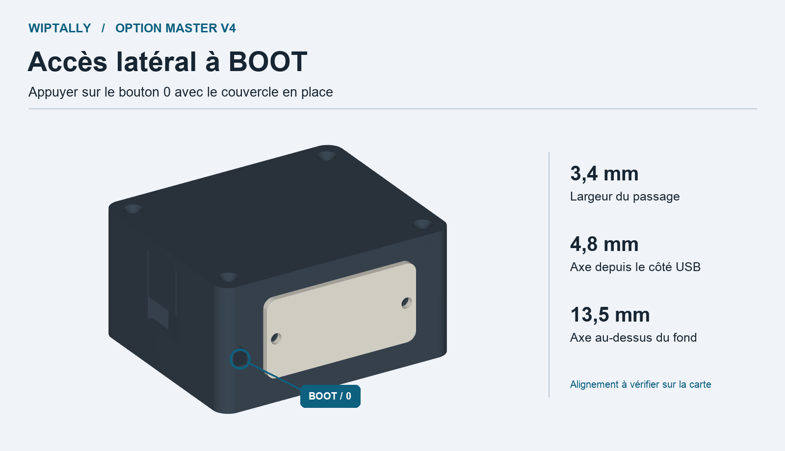

# Accès BOOT pour le master V4

Ce socle optionnel donne accès au bouton latéral **0 / BOOT** de la LOLIN S2 Mini par un petit passage sur le côté. Le couvercle V4 existant se remet avec ses quatre vis. Le master peut rester dans le boîtier pendant la récupération USB.

- [STL à imprimer](Socle-V4-master-acces-BOOT.stl)
- [STEP modifiable](Socle-V4-master-acces-BOOT.step)
- [Cotes et contrôles](verification.json)

## Montage

Imprimer le nouveau socle à **100 %**, fond sur le plateau, comme le socle V4. Le passage fait **3,4 mm de large** et traverse la paroi sous le logement de la vis. Son axe est à **4,8 mm du côté USB** et **13,5 mm au-dessus du fond**. En regardant la carte par-dessus avec le connecteur USB vers soi, l’accès est du côté droit, vers le bouton **0**.

Le placement du bouton est **estimé d’après la photo Wemos de la V1.0.0**. Vérifier à blanc l’alignement sur la carte réelle et le trajet de la tige avant de fermer. Le modèle a été contrôlé en CAO et reste à valider sur une impression. Garder les fils dégagés du passage.

Si tu préfères garder le socle déjà imprimé, relever l’axe réel du bouton sur le montage à blanc avant de reporter l’emplacement. Déposer la carte avant de modifier le plastique. Les cotes nominales ci-dessus servent de repère.

## Récupérer une carte invisible dans Atelier

1. Débrancher l’alimentation du tally.
2. Appuyer sur **0 / BOOT** à travers le passage avec une tige fine en plastique d’environ **1,5 mm de diamètre** et d’au moins **15 mm de longueur utile**.
3. Rebrancher l’USB au Mac en maintenant le bouton. Relâcher dès que la carte apparaît.
4. Pour une mise à jour, flasher dans Atelier et attendre le redémarrage automatique. Pour simplement revenir au tally, couper puis rétablir l’alimentation avec le bouton relâché.

L’entrée en mode BOOT sert à rendre la carte accessible à l’ordinateur. L’écriture du firmware commence quand le flash est lancé.

[Photos et dimensions Wemos](https://docs.wemos.cc/en/latest/s2/s2_mini.html) · [Démarrage en mode téléchargement](https://docs.espressif.com/projects/esptool/en/latest/esp32s2/esptool/entering-bootloader.html)

Le script `generer.py` part du STEP du socle V4 et des paramètres dans le dossier parent. Il utilise les [dépendances de la V4](../sources/requirements.txt).
